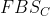
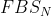
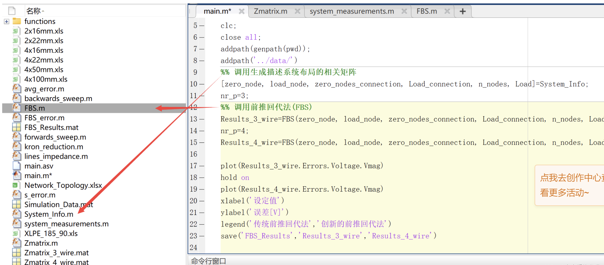
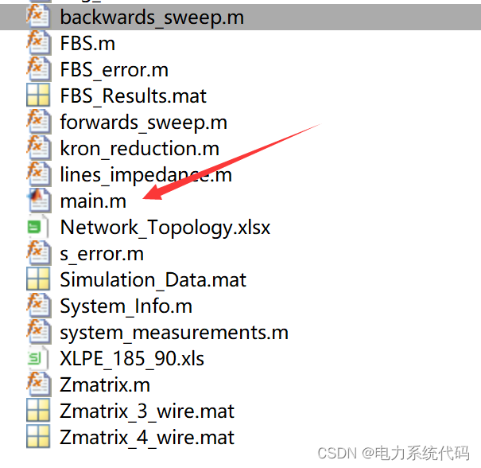
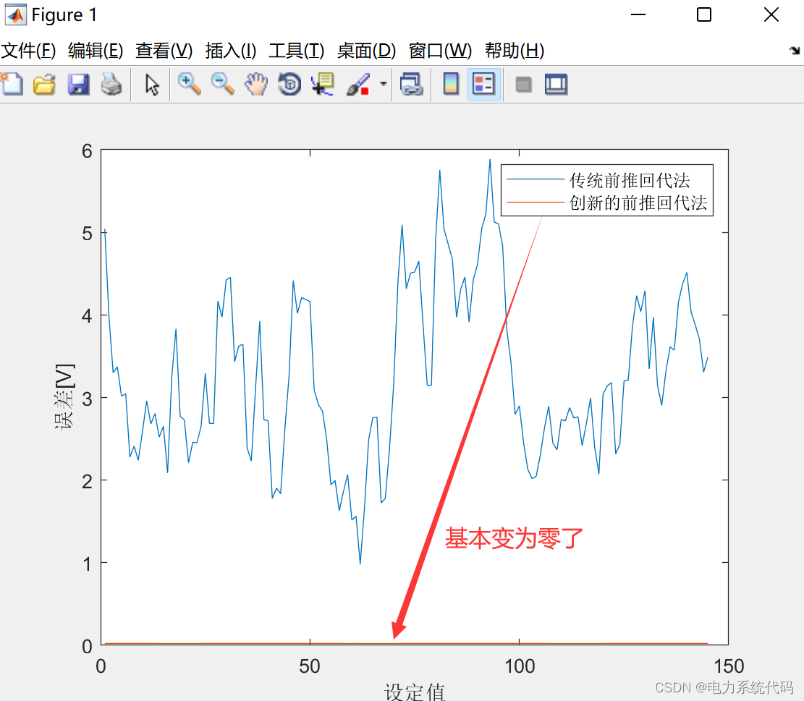

# MATLAB|Improved Preconditioned Iterative Solver for Low Voltage Distribution Network Flow Analysis

​  
Contents
1. Abstract
2. Comparison between traditional forward substitution and modified forward substitution
3. MATLAB code implementation
4. Simulation results
Editor
1. Abstract: The share of solar energy in the energy structure of residential rooftop photovoltaic (PV) systems is increasing, and electric vehicles (EVs) are ultimately achieving electrification of the transportation sector, which are some of the main reasons behind unprecedented technological growth in recent years. These advancements have brought new challenges to distribution system operators (DSOs) regarding the safe and reliable operation of their networks. Therefore, possessing accurate and reliable tools for research, identifying potential issues, and proactively mitigating these issues before costly failures or equipment malfunctions occur is crucial. The most commonly used tool for such research is power flow analysis, which provides the amplitude and phase angles of all voltages and currents in the power system for a given set of input parameters. Traditional Gauss-Seidel and Newton-Raphson power flow methods focus on equilibrium operations, allowing only positive sequence analysis. In contrast, distribution systems, especially low voltage distribution grids (LVDG), operate under highly unbalanced conditions. Consequently, both negative and zero sequence components must be considered, necessitating multiphase analysis. Currently, the primary methods for solving distribution network power flow problems either concentrate on current injection based on the Newton-Raphson formula or back substitution method.
1. The front-running back substitution method is the most commonly used power flow calculation method in radial low voltage distribution networks (LVDG). In most cases, the Kron reduction method is used to merge neutral conductors with phase conductors. However, ignoring the effect of neutral conductors through the Kron reduction method may lead to important information being lost, as in LVDG, most loads are connected in a single phase and supplied through both phase and neutral conductors. In this paper, modifications to the front-running back substitution method are made to consider neutral point voltage. Test results indicate that it is very important to understand the exact configuration of neutral conductors before conducting power flow studies in LVDG, as it will greatly affect the accuracy of the results.
2. Comparison between traditional front-running back substitution method and modified front-running back substitution method Due to the unbalanced characteristics of LVDG and the main single-phase loads (asymmetrical load conditions), a significant portion of total load current flows through neutral conductors. Especially in systems where neutral conductors only ground at MV-LV substations, this leads to noticeable voltage drops at their two ends. Using the Kron simplification to simplify the problem and merge neutral conductors with phase conductors not only produces incorrect results but also loses important information, as most loads in such systems are connected between phase and neutral conductor lines. This paper draws inspiration from [1] and expands it to apply only in LVDG where neutral conductors only ground at MV-LV substations. Additionally, comparisons are made between the traditional front-running back substitution method () described in [3] using Kron reduction, FBS () described in [4], and the method () presented in this paper. Results show significant improvements in accuracy and robustness, indicating the importance of understanding the exact configuration of neutral conductors before conducting power flow studies in LVDG.
3. MATLAB code implementation: Only partial code is shown here; all code points:
\n        \n  
​Edit
4. Simulation results
References:
[1] Gu Chen, Le Xiufan, Zhang Xiaoming. Three-phase power flow calculation of weak loop distribution networks based on improved pre-backward substitution method [J]. Power System Protection and Control, 2010(19):5. DOI:10.3969/j.issn.1674-3415.2010.19.030.
[2] Wang Zheng, Cong Peijie. Three-phase power flow calculation of radial distribution networks based on improved pre-backward substitution method [J]. Northeast Electric Power Technology, 2008(2):4. DOI:10.3969/j.issn.1004-7913.2008.02.002.
[3] Chen Yanping, Wang Qi, Zhao Rahong, et al. Three-phase power flow calculation method of radial distribution networks based on improved pre-backward substitution method [J]. Journal of Nanjing Normal University: Engineering Technology Edition, 2008, 8(1):6. DOI:10.3969/j.issn.1672-1292.2008.01.005.
[4] Mi Wenbo, Wang Yu, Liu Qingrui. Power flow calculation and analysis of distribution networks based on improved pre-backward substitution method [J]. Science Outlook, 2017(05):93-94. DOI:CNKI:SUN:KJZW.0.2017-05-080.

## Images

<!-- PAYMENT_BLOCK -->

## Get this dataset

- Payment link (Stripe): [Buy now](https://buy.stripe.com/3cs8yP7sY87d0vu9AB)
- Payment QR code: 

<!-- /PAYMENT_BLOCK -->
